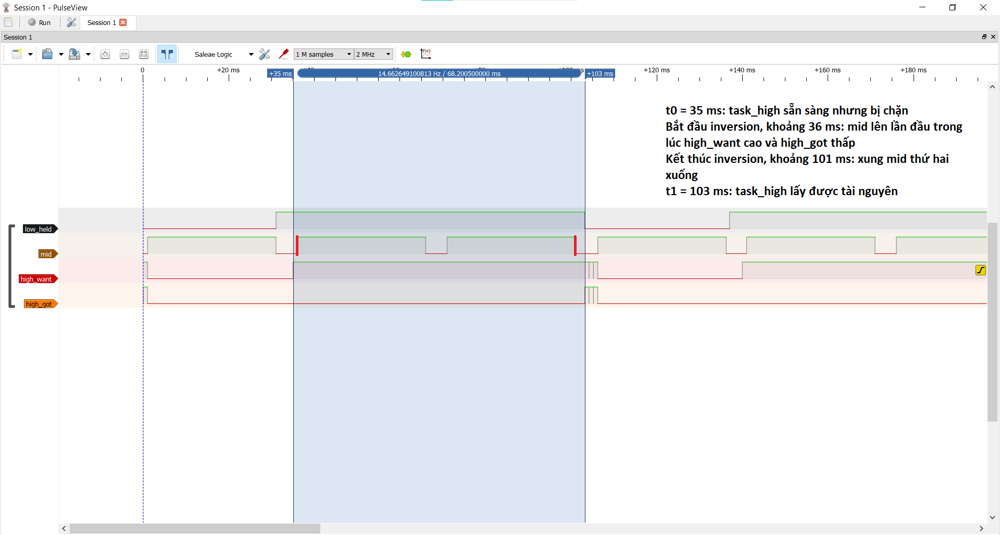
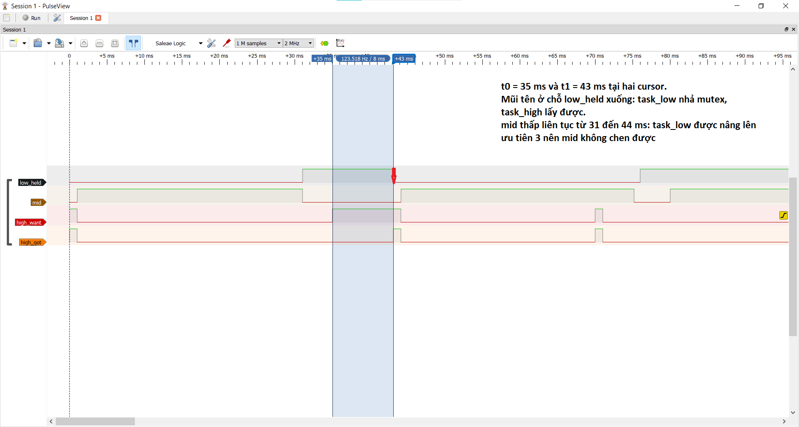
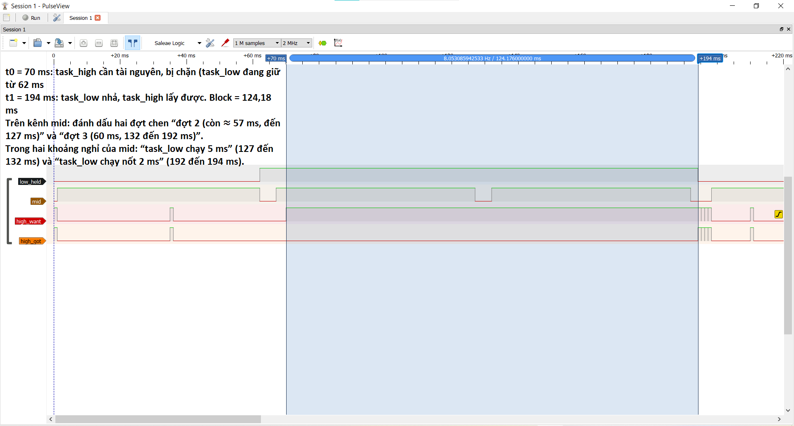

# Report — Week 2 / Ex3

`student_id`: 2413858    Commit của PREDICTION.md: 1108c9c

## 1. Ảnh đo
Binary semaphore: 
Mutex: 

Trên mỗi ảnh, đánh dấu: thời điểm `task_high` sẵn sàng chạy (t0), thời điểm nó
thực sự chạy (t1). Thời gian block = t1 − t0.

Bộ tham số dùng cho cả hai ảnh: `LOW_HOLD_MS` = 12, `MID_WORK_MS` = 30, `HIGH_PERIOD_MS` = 35, `DEADLINE_MS` = 15 (ms). Kênh logic analyzer: `low_held` = PA0 (task_low đang giữ tài nguyên), `mid` = PA1 (task_mid đang chạy), `high_want` = PA2 (task_high cần tài nguyên), `high_got` = PA3 (task_high lấy được tài nguyên). Mốc 0 ms là cạnh lên đầu tiên của `high_want` (trigger), bắt ngay sau khi reset board.

Đánh dấu trên ảnh binary semaphore (`inversion_binsem.png`):
- **t0 = 35 ms**: `high_want` lên, `task_high` sẵn sàng nhưng bị chặn (`high_got` vẫn thấp).
- **Bắt đầu inversion ≈ 36 ms**: `mid` lên trong lúc `high_want` cao và `high_got` thấp, tức `task_mid` bắt đầu chen vào `task_low`.
- **Kết thúc inversion ≈ 101 ms**: xung `mid` thứ hai xuống.
- **t1 = 103 ms**: `low_held` xuống (task_low nhả tài nguyên), `high_got` lên, `task_high` lấy được tài nguyên.

Đánh dấu trên ảnh mutex (`inversion_mutex.png`):
- **t0 = 35 ms**: `high_want` lên, `task_high` bị chặn.
- **t1 = 43 ms**: `low_held` xuống (task_low nhả mutex), `high_got` lên.
- Trong khoảng 31 đến 44 ms kênh `mid` ở mức thấp liên tục.

Ảnh bổ sung: `watch_binsem.png`, `watch_mutex.png` (cửa sổ Watch của debugger) và `inversion_binsem_mid60.png` (câu hỏi đánh đổi ở mục 6).

## 2. Bảng thời gian block
| Cấu hình | t0 (us) | t1 (us) | Block (us) | Đạt `DEADLINE_MS`? |
|---|---|---|---|---|
| Binary semaphore | ≈ 35 000 | ≈ 103 200 | 68 200 | Không (68,2 ms > 15 ms) |
| Mutex | ≈ 35 000 | ≈ 43 100 | 8 096 | Có (8,1 ms < 15 ms) |

Ghi chú về cách đọc số:
- Block là khoảng Δ giữa hai cursor trong PulseView (lấy mẫu 2 MHz): binary 68,2005 ms, mutex 8,096 ms. Nhãn cursor chỉ hiện số làm tròn nên t1 được tính bằng t0 + Δ.
- Đối chiếu bằng bộ đếm DWT (biến `g_high_block_us`, ảnh `watch_binsem.png`): binary 68 164 us, khớp 68 200 us trên logic analyzer.
- Ở mutex (ảnh `watch_mutex.png`), `g_high_block_us` đọc được 10 103 us. Đó là một chu kỳ khác với chu kỳ trên ảnh (8,096 ms): mỗi chu kỳ `task_low` đã chạy được số ms khác nhau khi `task_high` đến. Cả hai đều nhỏ hơn `LOW_HOLD_MS` (12 ms) và nhỏ hơn `DEADLINE_MS` (15 ms), nên kết luận đạt không đổi.
- `g_low_prio_max` (lấy bằng `uxTaskPriorityGet(NULL)` trong lúc task_low giữ tài nguyên): binary = 1, mutex = 3.
- Ở ảnh Watch của binary, `g_high_miss_count` = 0 vì breakpoint dừng ngay trước dòng `g_high_miss_count++`, nên số 0 đó không có nghĩa là chưa trượt deadline.

## 3. Vì sao mutex ngắn hơn
Giải thích bằng priority inheritance: `task_low` được nâng lên ưu tiên nào, khi
nào, và việc đó ngăn `task_mid` chen vào như thế nào.

`task_low` được nâng từ ưu tiên 1 lên **3** (bằng ưu tiên của `task_high`), vào đúng lúc `task_high` gọi `xSemaphoreTake` và bị chặn, tức t0 = 35 ms. Kernel làm được việc này vì mutex có chủ sở hữu: nó biết `task_low` đang giữ mutex nên nâng ưu tiên task đó lên mức của task đang chờ.
- Khoảng 36 ms `task_mid` (ưu tiên 2) hết thời gian nghỉ và Ready, nhưng 2 < 3 nên **không preempt được** `task_low`. Trên ảnh `mid` ở mức thấp liên tục từ 31 đến 44 ms.
- `task_low` chạy liền phần còn thiếu của lần giữ tài nguyên (khoảng 8 ms, đã chạy được khoảng 4 ms trước t0) và nhả mutex ở **43 ms**. Lúc nhả, ưu tiên của `task_low` trở về 1 và `task_high` lấy được mutex ngay (t1).
- Vì vậy block ≈ phần còn lại của lần giữ tài nguyên, không bao giờ vượt `LOW_HOLD_MS` = 12 ms, không còn cộng thêm `MID_WORK_MS`.
- Bằng chứng trực tiếp: `g_low_prio_max` = 3 ở mutex so với 1 ở binary semaphore. Binary semaphore không có chủ sở hữu nên kernel không biết cần nâng ưu tiên task nào, `task_low` vẫn ở ưu tiên 1 và `task_mid` chen vào được.

Ưu tiên đã chọn: `task_low` = 1, `task_mid` = 2, `task_high` = 3 (`tskIDLE_PRIORITY` = 0 dành cho idle task).
- Ba giá trị khác nhau, nên không có time-slicing giữa các task cùng mức, và `task_mid` nằm đúng giữa `task_low` và `task_high`. Đó là điều kiện để `task_mid` preempt được `task_low` khi `task_high` đang chờ.
- `configMAX_PRIORITIES` = 5 (ưu tiên hợp lệ 0 đến 4), `task_high` = 3 < 5. Có `_Static_assert` trong `app_main.c` kiểm tra điều này lúc biên dịch.
- `configUSE_TIMERS` = 0 nên không có task timer nào trùng dải ưu tiên.

## 4. task_mid trong lúc inversion
Mô tả trạng thái kênh `task_mid` trên ảnh binary semaphore trong khoảng
inversion — chạy bao nhiêu lần, mỗi lần bao lâu.

Trong khoảng `task_high` bị chặn (35 đến 103 ms), kênh `mid` chạy **hai lần**:
- Lần 1: khoảng 36 đến 66 ms, dài khoảng **30 ms**.
- Nghỉ khoảng **5 ms** (66 đến 71 ms, `vTaskDelay`), `mid` thấp, chỉ trong lúc này `task_low` mới có CPU.
- Lần 2: khoảng 71 đến 101 ms, dài khoảng **30 ms**.

Trước t0 còn một lần chạy nữa (khoảng 1 đến 31 ms), không nằm trong khoảng bị chặn. Kênh `low_held` cao liên tục khoảng 72 ms (31 đến 103 ms), dù công việc thật của `task_low` chỉ 12 ms, vì nó bị preempt nhưng vẫn giữ tài nguyên.

Phân rã 68,2 ms block: 60 ms do hai lần `task_mid` chen vào (phần inversion), 8 ms là `task_low` chạy nốt phần việc của nó (1 ms sau t0, 5 ms trong khoảng nghỉ, 2 ms cuối), phần chờ hợp lệ.

## 5. Lệch so với dự đoán
Mỗi mục lệch + nguyên nhân vật lý.

- **Block binary: dự đoán 68 ms, đo 68,2 ms** (logic analyzer 68,2005 ms, DWT 68,164 ms), lệch khoảng +0,2 ms (0,3%). Nguyên nhân vật lý: thời gian lập lịch thực (ngắt SysTick, PendSV, context switch mỗi lần task đổi chỗ) mà mô phỏng bỏ qua, cộng với làm tròn theo tick 1 ms. Mình không tách được phần của từng nguyên nhân.
- **Hai cách đo chênh nhau khoảng 36 us** (68 200 us trên logic analyzer so với 68 164 us bằng DWT): nằm trong sai số đặt cursor bằng tay và vị trí lấy mốc khác nhau (DWT lấy mẫu quanh lệnh ghi GPIO, logic analyzer đo cạnh trên chân).
- **Block mutex: dự đoán 8 ms, đo 8,096 ms**, khớp trong sai số. Chu kỳ khác (đọc bằng Watch) cho 10,103 ms, lệch do pha khác: `task_low` mới chạy ít hơn khi `task_high` đến nên còn thiếu nhiều hơn. Vẫn nằm dưới chặn trên 12 ms.
- **Hiện tượng chưa dự đoán: `task_high` chạy bù sau t1** ở binary. Nguyên nhân: block 68 ms dài hơn chu kỳ 35 ms nên đã lỡ các mốc, `vTaskDelayUntil` thấy mốc đã qua và trả về ngay, `task_high` chạy liên tiếp với block gần 0 cho đến khi bắt kịp.
- **Kênh `task_mid` ở mutex**: quan sát thấp liên tục từ 31 đến 44 ms (không chạy), phù hợp cơ chế inheritance; `PREDICTION.md` không nêu rõ điểm này.
- Các dự đoán còn lại (`task_low` chạy khoảng 4 ms trước t0, hai đợt `mid` khoảng 30 ms nghỉ khoảng 5 ms) khớp, không lệch.

## 6. Câu hỏi đánh đổi
Với bộ tham số của **bạn**, nếu `MID_WORK_MS` tăng gấp đôi thì thời gian block ở
cấu hình binary semaphore tăng thêm bao nhiêu? Trả lời bằng số từ dữ liệu của
bạn, rồi đo lại để kiểm chứng. `task_high` còn đạt `DEADLINE_MS` không?

**Dự đoán từ dữ liệu của mình:** với `MID_WORK_MS` = 60, `task_mid` vẫn chen hai lần, mỗi lần dài thêm 30 ms nên cộng đơn giản là + 60 ms. Nhưng pha thời gian thay đổi nên mình mô phỏng lại timeline: lúc 35 ms `task_high` thức dậy khi `task_mid` còn đang chạy lần 1 và `task_low` chưa từng chạy, nên lần này nó lấy được tài nguyên ngay (block ≈ 0). Lần bị chặn thật dời sang t0 ≈ 70 ms. Mô phỏng ra block ≈ 57 + 5 + 60 + 2 = 124 ms, tức tăng khoảng 56 ms, không phải đúng 60 ms.

**Đo lại** (`inversion_binsem_mid60.png`, binary semaphore, `MID_WORK_MS` = 60):

- t0 = 70 ms, t1 = 194 ms, **block = 124,176 ms**.
- So với 68,2 ms ở `MID_WORK_MS` = 30: **tăng thêm khoảng 56 ms** (khoảng +82%).
- Khớp mô phỏng 124 ms. Chênh với cách cộng đơn giản (+60 ms) là 4 ms, giải thích bằng hai khoản trừ: (1) tại t0 = 70 ms `task_mid` đã chạy được 3 ms của đợt hiện tại nên chỉ còn khoảng 57 ms nằm trong khoảng block (− 3 ms); (2) không có 1 ms `task_low` chạy ngay sau t0 như ở cấu hình `MID_WORK_MS` = 30 (− 1 ms). 60 − 3 − 1 = 56 ms.
- Phân rã trên ảnh: `mid` đợt 2 còn khoảng 57 ms, `task_low` chạy 5 ms, `mid` đợt 3 dài 60 ms, `task_low` chạy nốt 2 ms.

**`task_high` còn đạt `DEADLINE_MS` không?** Không: 124,2 ms ≫ 15 ms (ở `MID_WORK_MS` = 30 cũng đã không đạt với 68,2 ms). Ở cấu hình mutex mình không đo lại với `MID_WORK_MS` = 60. Theo cơ chế inheritance block bị chặn trên bởi `LOW_HOLD_MS` (12 ms) nên không phụ thuộc `MID_WORK_MS`, nhưng đó là suy luận chứ chưa phải số đo.

Lưu ý: `MID_WORK_MS` = 60 chỉ dùng tạm cho phép đo này. Các số ở mục 2 dùng bộ tham số gốc 12 / 30 / 35 / 15 ms.