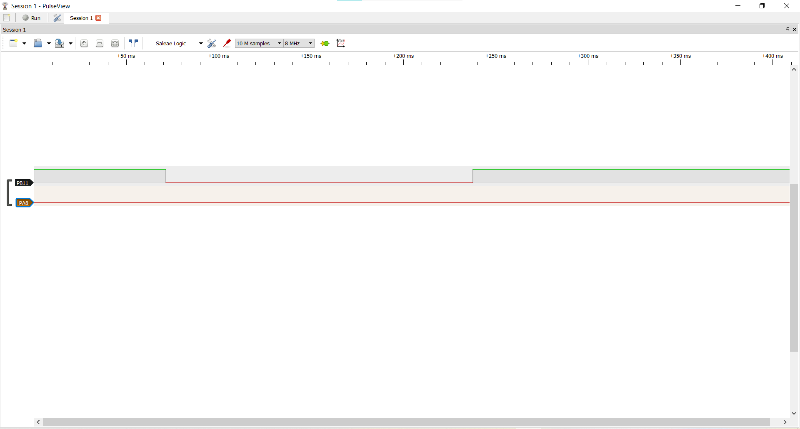
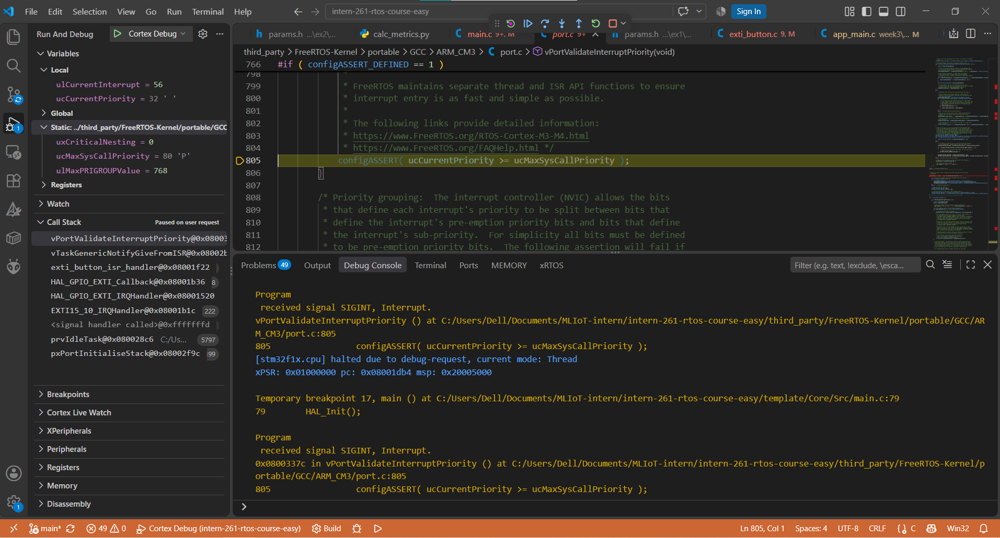
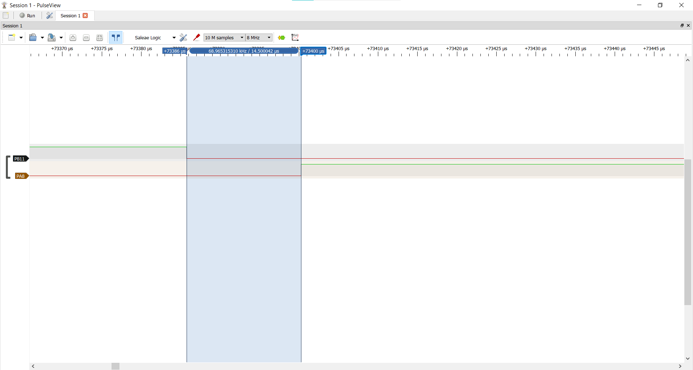
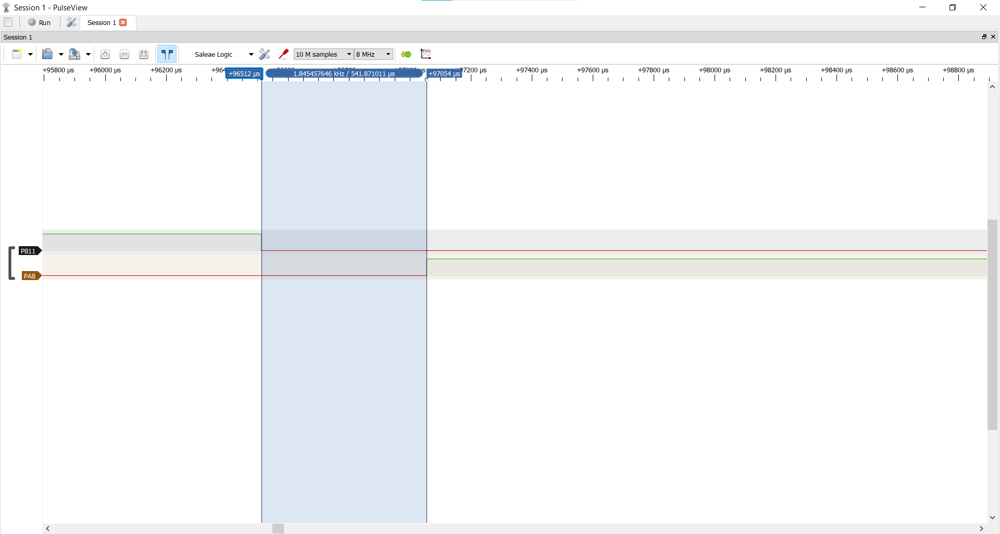
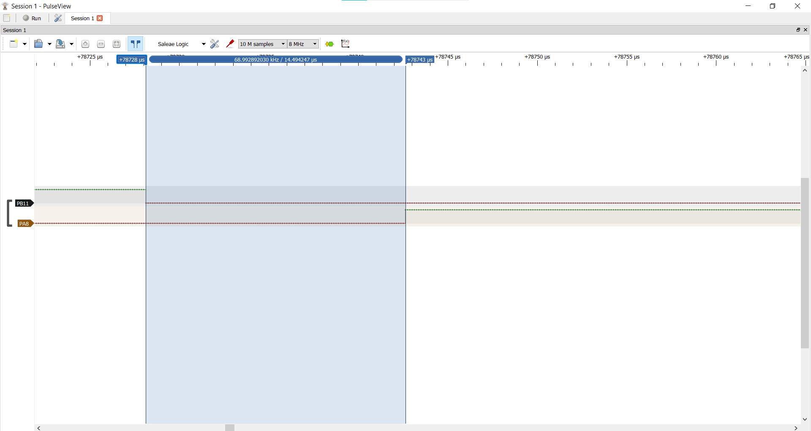

# Report — Week 3 / Ex1

`student_id`: 2413858    Commit của PREDICTION.md: 6b55110

## 1. Bằng chứng configASSERT
Mô tả/log/ảnh lúc priority sai (bước 4 README) + giải thích chính xác **vì sao**
assert được kích hoạt (nêu đúng tên macro và điều kiện).

**Trả lời:**

Cấu hình thử: `EXTI_WRONG_PRIO_TEST = 1`, `EXTI_WRONG_PRIO_VALUE = 2`, tức
`HAL_NVIC_SetPriority(EXTI15_10_IRQn, 2, 0)`. Với `NVIC_PRIORITYGROUP_4`, giá trị
ghi vào thanh ghi là `2 << 4 = 0x20`, nhỏ hơn
`configMAX_SYSCALL_INTERRUPT_PRIORITY = 5 << 4 = 0x50` (ưu tiên phần cứng cao hơn
ngưỡng cho phép).

Hiện tượng: khi nhấn nút, PB11 xuống thấp nhưng PA8 không đổi mức; chương trình
treo, không reset, không có đầu ra UART. Debugger dừng tại `port.c:805` trong
`vPortValidateInterruptPriority` với `ulCurrentInterrupt = 56` (EXTI15_10),
`ucCurrentPriority = 32` (0x20) và `ucMaxSysCallPriority = 80` (0x50). Call stack:
`vPortValidateInterruptPriority` ← `vTaskGenericNotifyGiveFromISR` ←
`exti_button_isr_handler` ← `HAL_GPIO_EXTI_Callback` ← `HAL_GPIO_EXTI_IRQHandler` ←
`EXTI15_10_IRQHandler`.

Lý do: `vTaskNotifyGiveFromISR` (thực chất là `vTaskGenericNotifyGiveFromISR`) chạy
macro `portASSERT_IF_INTERRUPT_PRIORITY_INVALID()` ngay đầu hàm; macro này gọi
`vPortValidateInterruptPriority()`. Hàm lấy số ngắt đang chạy và priority đã cấu
hình của nó, rồi đòi:

    configASSERT( ucCurrentPriority >= ucMaxSysCallPriority );   /* port.c:805 */
    32 >= 80  =>  sai

Điều kiện sai nên `configASSERT` thực thi `taskDISABLE_INTERRUPTS(); for( ;; );`:
tắt ngắt rồi lặp vô hạn, nên hệ thống treo tại chỗ.

Ảnh bằng chứng:

## 2. Latency ISR → task
| Cấu hình | Dự đoán (us) | Đo được (us) | Đạt `LATENCY_BUDGET_US`? |
|---|---|---|---|
| Có `portYIELD_FROM_ISR` | khoảng 10 (7 đến 15) | 14,500 (1 lần đo) | Đạt (14,5 < 50) |
| Không có `portYIELD_FROM_ISR` | khoảng 10 + (0 đến 1000), trung bình thêm khoảng 500 | 541,871 (1 lần đo) | Không đạt (541,9 > 50) |

Ảnh logic analyzer đính kèm cho cả 2 cấu hình.

**Trả lời:** đo bằng Saleae Logic (PulseView) ở 8 MHz, độ phân giải 125 ns; latency
là khoảng cách từ cạnh xuống của PB11 đến cạnh đổi mức của PA8, đọc bằng hai cursor.
`LATENCY_BUDGET_US = 50`.

Có `portYIELD_FROM_ISR`: cursor từ +73386 us đến +73400 us, khoảng cách 14,500 us.

Không có `portYIELD_FROM_ISR`: cursor từ +96512 us đến +97054 us, khoảng cách 541,871 us.

## 3. Giải thích quan hệ priority
Giải thích bằng lời của bạn: số NVIC priority nhỏ/lớn nghĩa là gì, vì sao
`configLIBRARY_MAX_SYSCALL_INTERRUPT_PRIORITY` tồn tại, điều gì xảy ra nếu một
ISR ưu tiên cao hơn ngưỡng này gọi API FreeRTOS.

**Trả lời:**

Số NVIC priority nhỏ nghĩa là ưu tiên cao, số lớn là ưu tiên thấp. STM32F103 có 4 bit
priority; với `NVIC_PRIORITYGROUP_4` cả 4 bit là preemption (0 đến 15) và được ghi
vào 4 bit cao của thanh ghi (`n << 4`). Ngắt có số nhỏ hơn có thể chen vào ISR có số
lớn hơn đang chạy.

`configLIBRARY_MAX_SYSCALL_INTERRUPT_PRIORITY` (= 5, thanh ghi 0x50) là mức ưu tiên
cao nhất (số nhỏ nhất) mà một ISR được phép gọi API `FromISR`. Nó tồn tại vì kernel
không bảo vệ dữ liệu của mình (danh sách ready, delayed, ...) bằng cách tắt hết ngắt,
mà bằng cách đặt `BASEPRI = 0x50` khi vào vùng găng: chỉ che các ngắt có số ≥ 5. Ngắt
có số < 5 không bị che nên vẫn chạy được ngay cả khi kernel đang sửa danh sách, vì
vậy chúng bị cấm gọi API FreeRTOS; ISR có số ≥ 5 thì bị BASEPRI che nên không chen
vào lúc đó được.

Nếu một ISR ưu tiên cao hơn ngưỡng (số < 5, ví dụ 2) gọi API FreeRTOS, nó có thể
ngắt kernel giữa lúc đang sửa cấu trúc dữ liệu rồi tự sửa tiếp chính cấu trúc đó, làm
hỏng danh sách (lỗi ngẫu nhiên, khó tìm). Vì thế `vPortValidateInterruptPriority`
kiểm tra `ucCurrentPriority >= ucMaxSysCallPriority` và `configASSERT` dừng chương
trình ngay (mục 1). `ISR_NVIC_PRIO = 7` (0x70) nằm trong khoảng hợp lệ 5 đến 15
(0x50 đến 0xF0).

## 4. Lệch so với dự đoán
Mỗi mục lệch + nguyên nhân vật lý (jitter NVIC, pipeline, v.v.).

**Trả lời:**

1. Latency có `portYIELD_FROM_ISR`: dự đoán khoảng 10 us (7 đến 15 us, 530 đến 940
   chu kỳ), đo được 14,500 us, khoảng 1044 chu kỳ ở 72 MHz. Lệch +4,5 us (+45%) so
   với giá trị trung tâm; nằm trong khoảng 7 đến 15 us nhưng vượt cận trên của bảng
   chu kỳ (940 chu kỳ = 13,1 us). Nguyên nhân khả dĩ (chưa tách đo riêng): build
   Debug `-O0` làm số lệnh của HAL và FreeRTOS nhiều hơn ước lượng; flash có wait
   state (`FLASH_LATENCY_2` ở 72 MHz) nên mỗi lệnh và mỗi lần rẽ nhánh tốn nhiều chu
   kỳ hơn CPI giả định 1,6; đường gọi có nhiều lớp (`EXTI15_10_IRQHandler` →
   `HAL_GPIO_EXTI_IRQHandler` → `HAL_GPIO_EXTI_Callback` →
   `exti_button_isr_handler`); PendSV chọn task theo cách tổng quát
   (`configUSE_PORT_OPTIMISED_TASK_SELECTION = 0`). Lệch này không đổi kết luận đạt
   (14,5 < 50).
2. Latency không có `portYIELD_FROM_ISR`: dự đoán thêm 0 đến 1000 us, trung bình
   khoảng 500 us; đo được 541,871 us, tức thêm khoảng 527 us so với 14,500 us, nằm
   trong khoảng dự đoán, nên không lệch. Chỉ có 1 lần đo nên chưa kiểm chứng được
   phân bố 0 đến 1 ms; phần đó dựa trên cơ chế SysTick 1 ms
   (`configTICK_RATE_HZ = 1000`).
3. Call stack lúc assert: dự đoán thiếu tầng `HAL_GPIO_EXTI_IRQHandler` và ghi tên
   `vTaskNotifyGiveFromISR`; thực tế là `EXTI15_10_IRQHandler` →
   `HAL_GPIO_EXTI_IRQHandler` → `HAL_GPIO_EXTI_Callback` và hàm trong stack là
   `vTaskGenericNotifyGiveFromISR` (vì `vTaskNotifyGiveFromISR` là macro). Nguyên
   nhân: dự đoán bỏ sót lớp HAL và lớp macro. Hành vi (treo, không reset, không
   UART; PB11 xuống mà PA8 không đổi) và điều kiện assert đúng như dự đoán.

## 5. Câu hỏi đánh đổi
Nếu tăng `ISR_NVIC_PRIO` của bạn lên một bậc (ưu tiên thấp hơn) trong khi vẫn
hợp lệ, latency đo được thay đổi bao nhiêu? Trả lời bằng số đo thật, không
đoán.

**Trả lời: gần như không đổi, thay đổi khoảng −0,006 us (khoảng 6 ns).**

Tăng `ISR_NVIC_PRIO` từ 7 lên 8 (0x70 → 0x80, vẫn trong khoảng 5 đến 15, không
assert), có `portYIELD_FROM_ISR`: latency 14,500 us (priority 7) và 14,494 us
(priority 8), mỗi giá trị 1 lần đo. Chênh lệch khoảng 6 ns, nhỏ hơn nhiều độ phân giải
125 ns của logic analyzer ở 8 MHz, nên không phân biệt được hai giá trị. Lúc nhấn chỉ
có ngắt này hoạt động (CPU ở Idle) nên đường đi ISR → task giống hệt nhau; priority
chỉ quyết định ngắt có chen được vào ngắt khác hay không, không làm ISR này chạy
nhanh hay chậm hơn.

