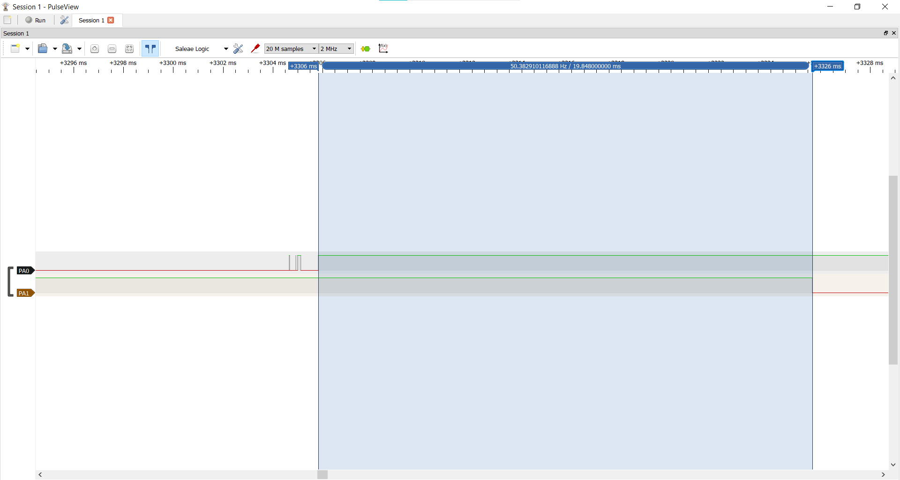
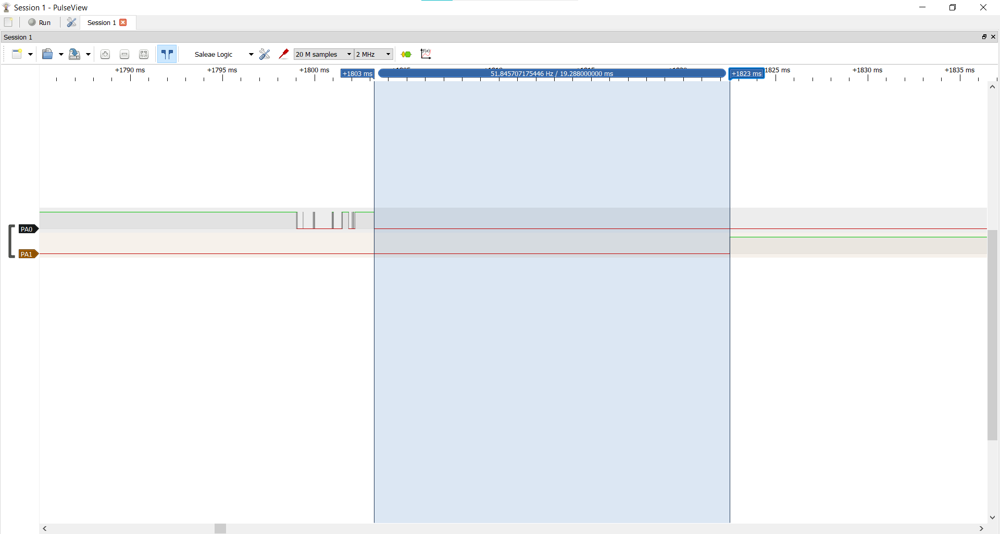

# Report — Week 3 / Ex2

`student_id`: 2413858    Commit của PREDICTION.md: f4e51c7

## 1. Nảy phím trước/sau
Ảnh logic analyzer: tín hiệu thô (nhiều cạnh nảy) và tín hiệu "PRESS" sau khi
qua `debounce_timer` (một cạnh sạch).

PulseView, Saleae Logic clone, 2 MHz, 20 M mẫu. D0 = PA0 (tín hiệu thô, nhấn = mức thấp), D1 = PA1 (tín hiệu sau debounce, cao = đang nhấn). `DEBOUNCE_MS` = 20 ms.



- Trước (PA0, thô): một lần thả của nút thật có cụm nhiều cạnh nảy trong khoảng 1,2 ms; log của ISR ghi `RELEASE ... edges=7`, trên ảnh thấy ít nhất 5 cạnh (hai xung hẹp và cạnh lên cuối), phần còn lại có thể quá hẹp để thấy ở 2 MHz.
- Sau (PA1): đúng một cạnh sạch, trễ 19,848 ms so với cạnh cuối cùng của PA0.
- Các phép đo khác của khoảng (cạnh cuối của PA0 → cạnh của PA1) nằm trong 19,0–20,0 ms (ví dụ 19,544; 19,568; 19,776; 19,968 ms). Nhỏ hơn `DEBOUNCE_MS` tối đa 1 ms vì hạn timer đếm theo tick 1 ms tính từ lúc ISR gửi lệnh, còn cạnh thật rơi giữa hai tick.
- Thống kê một lần chạy 14 nhấn/thả bằng nút thật: 14/14 lần nhấn sạch (`edges=1`), 13/14 lần thả sạch, 1 lần thả có `edges=2`; mọi lần đều chỉ ra đúng một PRESS và một RELEASE.



- Dây quẹt GND (nảy nặng hơn nút, chỉ để kiểm chứng): 12 sự kiện chính thức, 7/12 sự kiện có bounce; log có cụm tới 25 cạnh vẫn chỉ ra một sự kiện. Ảnh minh hoạ một lần nhấn có cụm khoảng 10 cạnh trong khoảng 4 ms (PA0 xuống, PA1 lên), trễ 19,288 ms.

## 2. Callback bị block — thí nghiệm bước 4
| | Dự đoán | Đo được |
|---|---|---|
| Độ trễ `longpress_callback` khi `debounce_callback` block 50ms | khoảng 30 ms (`held=70` thay vì 40); công thức độ trễ = 50 − x, với x = 20 ms là khoảng từ lúc bắt đầu block đến hạn của longpress | 33 ms (`held=73` thay vì 40), giống nhau ở 7/7 lần; đối chứng không block: `held=40` ở 7/7 lần |

Cách thử (chỉ trên nhánh tạm, không sửa `params.h`): chu kỳ `longpress_timer` tạm đặt 40 ms; cuối `debounce_callback` thêm `vTaskDelay(pdMS_TO_TICKS(50))` kèm `printf` `BLOCK`. Giữ nút khoảng 0,3-0,7 s.

Log timestamp (`xTaskGetTickCount()`) của cả hai callback quanh lúc bị block.

Có block (C1), lần 1: `debounce_callback` (PRESS, BLOCK) và `longpress_callback` (HELD):
```
PRESS t=7396 edges=1 since_last_edge=20 ms
BLOCK enter=7398 exit=7448
HELD t=7449 held=73 ms
HELD t=7456 held=80 ms
HELD t=7496 held=120 ms
```
Không block (C0, đối chứng), lần 1:
```
PRESS t=14173 edges=1 since_last_edge=20 ms
HELD t=14193 held=40 ms
HELD t=14233 held=80 ms
```
Cả 7 lần của C1:

| Lần | PRESS t | BLOCK enter→exit | HELD đầu (t, held) | HELD thứ hai (t, held) |
|---|---|---|---|---|
| 1 | 7396 | 7398→7448 | 7449, 73 | 7456, 80 |
| 2 | 8903 | 8905→8955 | 8956, 73 | 8963, 80 |
| 3 | 10529 | 10531→10581 | 10582, 73 | 10589, 80 |
| 4 | 12164 | 12166→12216 | 12217, 73 | 12224, 80 |
| 5 | 13873 | 13875→13925 | 13926, 73 | 13933, 80 |
| 6 | 15505 | 15507→15557 | 15558, 73 | 15565, 80 |
| 7 | 17113 | 17115→17165 | 17166, 73 | 17173, 80 |

Hạn của longpress là 7376 + 40 = 7416 (cạnh cuối ở t=7376), nằm giữa cửa sổ block 7398→7448, nên HELD chạy ở 7449: muộn 33 ms.

## 3. Giải thích daemon task
Giải thích **bằng cơ chế**, không chỉ hiện tượng: vì sao một callback block sẽ
ảnh hưởng timer khác, liên hệ đến timer command queue và việc có đúng MỘT
daemon task xử lý tất cả software timer.

Mọi software timer chạy callback trên một task duy nhất là timer daemon (ưu tiên `configTIMER_TASK_PRIORITY` = 4). ISR không chạy callback: `xTimerResetFromISR`, `xTimerStartFromISR`, `xTimerStopFromISR` chỉ đóng dấu tick lúc gửi (t_gửi) và đẩy một lệnh vào timer command queue. Daemon lặp: xử lý tối đa MỘT timer đã quá hạn (gọi callback của nó), rồi lấy TOÀN BỘ lệnh trong queue ra áp dụng, rồi mới sang vòng sau (đối chiếu với `timers.c` V11.1.0). Hạn của một timer là E = t_gửi + chu kỳ.

Callback chạy tuần tự trong cùng task đó, nên `vTaskDelay(50)` trong `debounce_callback` đưa chính daemon task vào trạng thái Blocked 50 ms. Trong cửa sổ đó daemon không gọi callback của timer nào khác dù hạn đã tới, và không lấy lệnh nào trong queue ra; ISR vẫn chạy và vẫn gửi lệnh được, lệnh chỉ nằm chờ (queue dài 16, đầy thì lệnh `...FromISR` bị bỏ). Không có task thứ hai nào chạy thay, vì cả hai timer cùng phụ thuộc một daemon.

Trong thí nghiệm: `debounce_callback` chạy ở t=7396, block từ 7398 đến 7448; hạn của `longpress_timer` là 7416, rơi vào cửa sổ block, nên `longpress_callback` chỉ được gọi khi daemon rảnh, ở t=7449, muộn 33 ms. Khớp công thức 50 − x: block bắt đầu ở t=7398, hạn cách 18 ms, độ trễ 50 − 18 = 32 ms, cộng thêm khoảng 1 ms in dòng `BLOCK`.

Độ trễ không cộng dồn: hạn tính từ t_gửi (không phải lúc daemon xử lý) và timer auto-reload tính hạn kế tiếp từ hạn gốc, nên lần HELD thứ hai ở t=7456 (`held=80`) về đúng lưới 40 ms.

Hệ quả suy ra từ `timers.c` (không đo): nếu người dùng thả phím trong cửa sổ block, lệnh Stop của `longpress_timer` nằm trong queue và được daemon xử lý trước khi gọi callback đã quá hạn, nên HELD đó bị MẤT chứ không chỉ trễ. Vì vậy callback không được block; bản nộp cuối không còn `vTaskDelay`.

## 4. Long-press
Thời gian giữ thực tế đo được so với `LONGPRESS_MS`: khớp không?

Khớp. `LONGPRESS_MS` = 1000 ms; `held` (tính từ cạnh xuống cuối cùng) đo được đúng 1000, 2000, 3000 ms, sai lệch 0 tick.

| Lần | PRESS t | HELD (`held`) | RELEASE t | Giữ (tick) |
|---|---|---|---|---|
| 1 | 37435 | 1000, 2000 | 40248 | 2813 |
| 2 | 41846 | 1000, 2000, 3000 | 45113 | 3267 |

Các dòng HELD liên tiếp cách đúng 1000 tick. Dòng HELD đầu cách dòng PRESS 980 tick (37435→38415, 41846→42826) vì dòng PRESS được in sau cạnh cuối 20 ms (`DEBOUNCE_MS`) còn `held` tính từ cạnh cuối. Thả phím thì timer bị Stop, không có HELD nào sau RELEASE.

## 5. Lệch so với dự đoán
Mỗi mục lệch + nguyên nhân.

1. Độ trễ khi block (Q3): dự đoán khoảng 30 ms (`held=70`), đo được 33 ms (`held=73`). Ví dụ trong dự đoán giả sử block bắt đầu đúng lúc x = 20 và `printf` không tốn thời gian. Thực tế dòng PRESS in mất 2 tick trước khi block bắt đầu (x = 18, độ trễ 32 ms), dòng `BLOCK` in sau khi block mất thêm khoảng 1 tick, ra 33 ms. Công thức 50 − x vẫn đúng.
2. Nảy khi nhấn (Q1): dự đoán nảy ở cả hai chiều; đo được lần nhấn gần như luôn `edges=1` (14/14 ở lần chạy §1; mọi PRESS ở các log 10 ms và 5 ms), bounce chủ yếu xuất hiện lúc thả (`edges` 2-7). Nguyên nhân chưa xác định; có thể do cơ cấu của nút (nhấn dứt khoát, thả bằng lò xo).
3. Trễ debounce (Q1): dự đoán "20 ms sau cạnh cuối", đo được 19,0-20,0 ms. Nguyên nhân: hạn của timer đếm theo tick 1 ms tính từ lúc ISR gửi lệnh, cạnh thật rơi giữa hai tick, nên sai lệch tối đa 1 tick.
4. Số cạnh ISR khác PulseView: có lần thả log ghi `edges=2` nhưng PulseView chỉ thấy một cạnh sạch (lần thả ở +8362 ms). Nghi do xung rất hẹp, dưới độ phân giải 0,5 µs của 2 MHz; chưa xác nhận.
5. Một số dòng RELEASE không có PRESS đứng trước (vài dòng khi khởi động/cắm dây, ví dụ t=10292, 10412, và một lần giữa chừng t=15439 `edges=3` ở lần chạy C1): không có trong dự đoán, nguyên nhân chưa xác định (nghi nhiễu chân kéo lên hoặc xung hẹp). Không ảnh hưởng các số liệu vì đã loại khỏi bảng.
6. Q2 (double-click khi `DEBOUNCE_MS` lớn): chưa đo trên board nên không có số liệu để so sánh.

## 6. Câu hỏi đánh đổi
Với `DEBOUNCE_MS` của bạn, nếu giảm xuống còn một nửa thì tín hiệu sau debounce
còn sạch không? Đo lại trên board của bạn, không suy luận suông.

Còn sạch. `DEBOUNCE_MS` = 20 ms, một nửa là 10 ms: 31 chu kỳ nhấn/thả cho đúng 31 PRESS và 31 RELEASE, xen kẽ, không có sự kiện thừa. Cách đo: giữ nguyên `params.h`, tạm sửa dòng tạo `s_debounce_timer` thành `pdMS_TO_TICKS(DEBOUNCE_MS / 2)`, rồi 5 và 2 ms (dòng tạm, đã gỡ khỏi bản nộp); đếm PRESS/RELEASE trong log UART, sự kiện thừa là hai sự kiện cùng loại liên tiếp hoặc cặp sự kiện cách nhau dưới 30 ms.

| `DEBOUNCE_MS` | Số chu kỳ | PRESS | RELEASE | Sự kiện thừa | Nhận xét |
|---|---|---|---|---|---|
| 20 (gốc) | 9 | 9 | 9 | 0 | 5/9 lần thả có bounce (`edges` 2-3), vẫn một sự kiện |
| 10 (một nửa) | 31 (8 + 23) | 31 | 31 | 0 | `edges` lớn nhất 5; PulseView đo trễ 9,70-9,74 ms |
| 5 | 20 | 20 | 20 | 0 | cụm 7 cạnh (`edges=7`) vẫn thành một sự kiện |
| 2 | 20 | 20 | 36 | 16 | không còn sạch: 6/20 lần thả sinh thêm RELEASE |

Ngưỡng hỏng của nút này nằm giữa 2 và 5 ms. Lý do cơ chế: debounce chỉ thất bại khi có khoảng lặng giữa hai cạnh liên tiếp lớn hơn `DEBOUNCE_MS`, vì lúc đó timer kịp hết hạn giữa cụm. Ở 2 ms, các RELEASE thừa tập trung thành cụm cách nhau 2-23 ms (ví dụ t=21604, 21606, 21623, 21625, 21646), lớn hơn cửa sổ 2 ms nên bị tách thành nhiều sự kiện.

Lưu ý: ở 2 ms, tín hiệu PA1 trên PulseView vẫn trông sạch vì RELEASE thừa chỉ ghi mức thấp lên PA1 đang thấp; lỗi chỉ thấy ở log (ứng dụng nhận nhiều sự kiện nhả cho một lần thả). Một vài RELEASE thừa cách nhau 160-350 ms (ví dụ t=10848, 11202) dài hơn mọi cửa sổ debounce thử, không giải thích được bằng cửa sổ 2 ms; có thể là nhiễu, chưa kết luận.